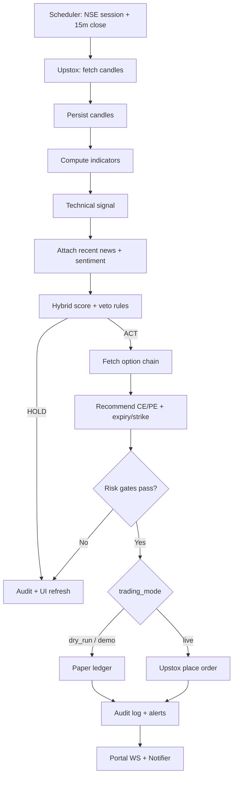

# NSE/BSE F&O Options Trading Signal Portal — Architecture Plan

**Audience:** engineering + product  
**Scope:** design & planning only (no full app scaffold)  
**Markets:** NSE / BSE cash + F&O (NIFTY, BANKNIFTY, stock F&O e.g. RELIANCE, TCS)  
**Broker:** Upstox (market data, option chain, orders)  
**UI:** local web portal  

Related artifacts:

| Artifact | Path |
|----------|------|
| Postgres schema | [options-portal/database-schema.md](./options-portal/database-schema.md) |
| Module interfaces | [options-portal/module-interfaces.md](./options-portal/module-interfaces.md) |
| UI wireframes | [options-portal/ui-wireframes.md](./options-portal/ui-wireframes.md) |
| Sample config | [options-portal/sample-config.yaml](./options-portal/sample-config.yaml) |
| Docker Compose outline | [options-portal/docker-compose.outline.yml](./options-portal/docker-compose.outline.yml) |
| `.env.example` | [options-portal/env.example](./options-portal/env.example) |

---

## 1. System overview

The portal is a **modular signal factory** with a thin orchestration layer:

1. **Market data ingest** pulls 15m (and optional 5m/1d) OHLCV candles and option chains via an Upstox adapter.
2. **Technical analysis (TA) plugins** compute indicators and emit structured technical signals.
3. **News/sentiment plugins** ingest RSS/filings, score sentiment, and attach context to underlyings/signals.
4. **Hybrid decision engine** merges TA + news into a scored recommendation (direction, confidence, suggested option legs).
5. **Execution adapter** places dry-run / demo / live orders through Upstox with hard risk gates.
6. **Audit + notifications + web UI** persist every decision, surface health, and alert operators.

```text
┌─────────────┐   ┌──────────────┐   ┌────────────────┐
│ Upstox API  │──▶│ Broker       │──▶│ Candle store / │
│ (MD+Orders) │   │ Adapter      │   │ Option chain   │
└─────────────┘   └──────────────┘   └───────┬────────┘
                                             │
┌─────────────┐   ┌──────────────┐           ▼
│ RSS / SEBI  │──▶│ News +       │──▶┌───────────────┐
│ Filings     │   │ Sentiment    │   │ Hybrid        │
└─────────────┘   └──────────────┘──▶│ Decision      │──▶ Options recos
                                     │ Engine        │
┌─────────────┐                      └───────┬───────┘
│ TA Plugins  │─────────────────────────────▶│
└─────────────┘                              ▼
                                   ┌─────────────────┐
                                   │ Risk gates +    │
                                   │ Order router    │──▶ Upstox / dry-run
                                   └────────┬────────┘
                                            ▼
                         ┌──────────────────────────────────┐
                         │ Postgres audit · Redis queues    │
                         │ Web portal · Alerts (Telegram/…) │
                         └──────────────────────────────────┘
```

### Design principles

- **Replaceable modules** behind stable interfaces (broker, TA, sentiment, notifier, scorer).
- **Mode switch:** `dry_run` | `demo` | `live` — live requires explicit admin enable + risk gates.
- **India-first domain:** NSE calendar, F&O universe, weekly index expiry / monthly stock expiry, IST session windows.
- **Local-first ops:** Docker Compose for single-operator deploy; secrets never in repo.
- **Every decision is auditable:** raw inputs → scores → recommendation → order attempt → fill/reject.

---

## 2. Modular plug-in architecture

Each capability is a package implementing a protocol/interface. The orchestrator depends only on interfaces (see [module-interfaces.md](./options-portal/module-interfaces.md)).

| Module | Responsibility | Default | Swap examples |
|--------|----------------|---------|---------------|
| `BrokerAdapter` | Auth, candles, option chain, place/cancel orders | Upstox | Zerodha Kite (future) |
| `IndicatorPlugin` | Pure functions on OHLCV → features | RSI, EMA, VWAP, Supertrend, IV/OI skew helpers | Custom TA |
| `SignalGenerator` | Features → `TechnicalSignal` | Rule-based 15m confluence | ML classifier |
| `NewsIngestor` | Poll RSS / filings → `NewsItem` | Moneycontrol, ET, LiveMint, NSE/BSE/SEBI | Paid news APIs |
| `SentimentScorer` | Text → polarity + labels | VADER (fast) + optional FinBERT | Hosted FinBERT |
| `HybridScorer` | TA + news → `HybridDecision` | Weighted score + veto rules | Bayesian / LLM summary |
| `OptionsRecommender` | Decision + chain → legs (CE/PE, strike, expiry) | ATM±N, delta/OI filters | Multi-leg spreads |
| `OrderRouter` | Mode-aware execution + risk gates | Upstox + paper ledger | — |
| `Notifier` | Push alerts | Telegram / email / webhook | Slack |
| `Portal API` | REST/WS for UI | FastAPI or NestJS | — |

### Orchestration sketch

```python
# Pseudocode — pipeline tick (e.g. every 15m close)
async def on_candle_close(symbol: str, timeframe: str = "15m"):
    candle = await market_store.latest(symbol, timeframe)
    features = ta_registry.compute_all(candle.history)
    tech = signal_generator.evaluate(symbol, features)

    news = await news_store.recent(symbol, lookback_minutes=180)
    sentiment = sentiment_scorer.score_batch(news)

    decision = hybrid_scorer.combine(tech, sentiment, session_context())
    if decision.action == "HOLD":
        await audit.log("hold", decision); return

    chain = await broker.get_option_chain(symbol, expiry=pick_expiry(symbol))
    reco = options_recommender.recommend(decision, chain, risk_profile)

    order_plan = risk_gates.validate(reco, portfolio, config.limits)
    result = await order_router.execute(order_plan, mode=config.trading_mode)

    await audit.log_full(tech, sentiment, decision, reco, order_plan, result)
    await notifiers.dispatch(result, decision)
    await portal_bus.publish("signal.updated", decision.id)
```

---

## 3. Suggested repository structure

```text
options-portal/
├── apps/
│   ├── api/                 # HTTP + WebSocket API (portal backend)
│   ├── worker/              # Candle/news pollers, pipeline runner
│   ├── portal-web/          # Local React/Vite UI
│   └── backtest-cli/        # Offline simulation entrypoint
├── packages/
│   ├── domain/              # Shared types, enums, IST calendar helpers
│   ├── broker-upstox/       # UpstoxAdapter implementing BrokerAdapter
│   ├── ta-core/             # Indicators + default SignalGenerator
│   ├── news-rss/            # RSS/filings ingestors
│   ├── sentiment/           # VADER + optional FinBERT client
│   ├── hybrid-engine/       # HybridScorer + OptionsRecommender
│   ├── risk/                # Gates, position limits, kill switch
│   ├── notify/              # Notifier implementations
│   └── persistence/         # Repositories (Postgres/Redis)
├── db/
│   ├── migrations/          # SQL / Alembic / Prisma
│   └── seeds/               # Roles, sample underlyings
├── config/
│   ├── default.yaml
│   ├── symbols.india.yaml   # index/stock metadata examples
│   └── universe/            # NSE F&O underlyings CSV snapshot (+ SOURCE.md)
├── deploy/
│   ├── docker-compose.yml
│   └── prometheus/          # Optional local metrics
├── tests/
│   ├── unit/
│   ├── integration/
│   └── fixtures/            # Candles CSV, news CSV, chain snapshots
├── scripts/                 # Health smoke, token refresh helpers
├── .env.example
└── README.md
```

**Monorepo rationale:** clear ownership boundaries, independent versioning of plugins, shared `domain` types, one Compose file for local ops.

---

## 4. Data stores

### Postgres (system of record)

Entities (full DDL in [database-schema.md](./options-portal/database-schema.md)):

- **users / roles** — `admin`, `analyst`, `guest`
- **instruments / underlyings** — NSE symbols, F&O flags, lot sizes
- **candles** — OHLCV by symbol/timeframe
- **news_items** + **news_sentiment** — live portal feed (today IST); see [news retention](./options-portal-news-retention.md)
- **news_items_history** + **news_sentiment_history** — daily archive until quarter-end (not shown on News UI)
- **signals** — technical + hybrid decisions
- **option_recommendations** — proposed legs
- **orders / fills** — dry-run and live
- **trades / positions / pnl_snapshots**
- **audit_events** — immutable JSON payloads
- **app_config** — non-secret runtime knobs (versioned)
- **health_checks** — component status history

### Redis (recommended)

- Pub/Sub for live UI updates (`signal.updated`, `order.status`)
- Short-TTL cache for option chain snapshots
- Rate-limit counters for Upstox + RSS
- Job queues (e.g. RQ / Celery / BullMQ) for news scoring and backtests

---

## 5. End-to-end workflow

### Mermaid — live pipeline



### Expiry selection (India)

| Underlying | Typical F&O expiry rule (config-driven) |
|------------|----------------------------------------|
| NIFTY / BANKNIFTY | Weekly (nearest eligible weekly) unless config forces monthly |
| RELIANCE / TCS (stocks) | Monthly (near-month by default; avoid illiquid far months) |

Avoid recommending contracts inside a configurable **expiry cut-off window** (e.g. last Thursday afternoon for weeklies) unless explicitly allowed.

### Pseudocode — hybrid + recommend

```text
tech_score   ∈ [-1, 1]   # e.g. +1 bullish CE bias
news_score   ∈ [-1, 1]   # FinBERT/VADER aggregate, time-decayed
conf_tech, conf_news     # [0, 1]

hybrid = w_t * tech_score * conf_tech + w_n * news_score * conf_news

if abs(news_score) > veto_threshold and sign(news) != sign(tech):
    action = HOLD  # news veto / conflict
elif hybrid > enter_long:
    action = BUY_CE_BIAS
elif hybrid < enter_short:
    action = BUY_PE_BIAS
else:
    action = HOLD

expiry = next_weekly(symbol) if is_index(symbol) else next_monthly(symbol)
strike = atm_from_spot(chain) ± strike_offset(decision)
filter: min OI, max spread%, delta band
size = min(max_lots, risk_budget / (premium * lot_size))
```

---

## 6. UI surfaces (summary)

Detailed ASCII/markdown wireframes: [ui-wireframes.md](./options-portal/ui-wireframes.md).

| Page | Purpose |
|------|---------|
| Dashboard | Paginated NSE F&O watchlist signals; mode badge; health strip |
| Signal drill-down | 15m chart context, TA reasons, news attachments, hybrid score breakdown |
| News | Feed with sentiment tags + symbol links |
| Trades / P&L | Paper + live fills, open positions, day P&L (₹) |
| Admin config | Symbols, weights, risk limits, mode switch (admin only) |
| Health | Upstox auth, RSS lag, worker heartbeat, DB/Redis |

---

## 7. Security & credentials

### Secrets

- **Never** commit API keys, access/refresh tokens, or DB passwords.
- Load from environment / Docker secrets / optional HashiCorp Vault (or local `sops`-encrypted file for single-operator).
- Upstox OAuth tokens: store encrypted at rest in Postgres or OS keyring; refresh via worker; rotate on 401.
- Sample pattern in [env.example](./options-portal/env.example).

### Roles (RBAC)

| Role | Capabilities |
|------|----------------|
| `admin` | Mode switch (incl. live), risk limits, user mgmt, all reads |
| `analyst` | View signals/news/trades, trigger dry-run, edit non-secret strategy weights (if allowed) |
| `guest` | Read-only dashboard + published signals (no P&L detail if configured) |

Local portal binds to `127.0.0.1` by default; TLS or SSH tunnel if exposed on LAN.

### App security baseline

- Session cookies: `HttpOnly`, `SameSite=Strict`, secure when TLS on.
- CSRF on state-changing routes; rate-limit auth endpoints.
- Audit every config change and every live order attempt.
- Kill switch: `TRADING_HALT=true` or admin UI → blocks OrderRouter immediately.

---

## 8. Error handling, rate limits, retries, health

| Concern | Approach |
|---------|----------|
| Upstox HTTP 429 / 5xx | Exponential backoff + jitter; circuit breaker after N failures; degrade to “stale data” UI |
| Auth expiry | Auto-refresh; on failure mark broker `unhealthy`, halt live orders |
| RSS parse failures | Per-source quarantine; continue other sources |
| Sentiment model timeout | Fall back to VADER-only; flag `sentiment_degraded` |
| Partial pipeline failure | Persist what succeeded; emit `audit_events` with `severity=error`; do not place orders on incomplete context if gate requires news |
| Idempotency | `client_order_id` / signal_id unique constraints for order attempts |
| Health checks | `/health/live`, `/health/ready` (DB + Redis + last candle age + token validity) |

Redis counters enforce per-endpoint RPM. Worker leases jobs with visibility timeout to avoid double execution.

---

## 9. Backtesting / simulation

**Inputs**

- Historical 15m candles (CSV or Upstox historical API dumps) under `tests/fixtures/candles/`.
- News CSV: `ts, symbol, source, title, body` aligned in IST.
- Optional option-chain snapshots (or synthetic chain from spot + fixed IV for v1).

**Approach**

1. Replay clock in IST; skip weekends/holidays via `IndiaMarketCalendar`.
2. At each bar close, run the same plugin pipeline as live (deterministic seeds).
3. Fill model: mid ± slippage_bps; reject if spread > max; respect lot size.
4. Modes: signal-only metrics vs paper P&L with fees/STT approximations (document assumptions).
5. Outputs: hit rate, profit factor, max drawdown, per-symbol notebooks/CSV; store run metadata in `backtest_runs` (optional table).

**CLI sketch:** `backtest-cli run --symbols NIFTY,BANKNIFTY --from 2024-01-01 --to 2024-06-30 --news fixtures/news.csv`

---

## 10. Local deployment outline

See [docker-compose.outline.yml](./options-portal/docker-compose.outline.yml) and [sample-config.yaml](./options-portal/sample-config.yaml).

**Services:** `postgres`, `redis`, `api`, `worker`, `portal-web`, optional `sentiment-gpu` (FinBERT).

**Secure local practices**

- Bind UI/API to localhost; do not publish Postgres/Redis ports to `0.0.0.0` on shared networks.
- Use Compose secrets or env files with `0600` permissions.
- Keep `trading.mode: dry_run` until risk gates and paper results are reviewed.
- Separate Upstox app credentials for sandbox vs production.
- Regular DB backups before enabling live.

---

## 11. Testing strategy (high level)

| Layer | Examples |
|-------|----------|
| Unit | Indicator math; expiry picker (weekly NIFTY vs monthly RELIANCE); hybrid veto rules; risk gate lot caps |
| Integration | Upstox adapter against recorded HTTP cassettes; RSS parser fixtures; order router dry-run → DB audit row |
| Contract | Plugin interface compliance tests (each adapter registers + round-trips types) |
| Health/smoke | Compose up → `/health/ready` green; one synthetic 15m tick produces signal + audit |
| Backtest regression | Golden run on fixed CSV fixtures; assert metric bands |

Example outlines:

```text
test_expiry_nifty_weekly_before_cutover()
test_hybrid_news_veto_blocks_conflicting_ta()
test_order_router_blocks_live_when_halt_set()
test_upstox_candle_ingest_persists_ohlcv()  # VCR cassette
test_health_ready_fails_when_redis_down()
```

---

## 12. Recommended stack (opinionated default)

| Layer | Suggestion | Rationale |
|-------|------------|-----------|
| Backend | **Python 3.12 + FastAPI** | TA/ML ecosystem, FinBERT, rapid numeric work |
| Worker | Same repo, asyncio or Celery/RQ | Shared domain packages |
| Web UI | **React + Vite + TypeScript** | Clear local portal, WS-friendly |
| DB | **Postgres 16** | Auditability, JSONB for payloads |
| Cache/queue | **Redis 7** | Pub/sub + rate limits + jobs |
| Sentiment v1 | **VADER** in-process | Zero GPU, good enough for MVP |
| Sentiment v2 | Optional **FinBERT** sidecar | Higher quality headlines |
| IaC local | Docker Compose | Single-operator |

Node/NestJS is viable if the team is TS-heavy; keep Python workers for TA/sentiment either way.

---

## 13. Open decisions for the user

1. **Backend language split:** Python-only monorepo vs Node API + Python worker.
2. **FinBERT hosting:** in-process CPU, local GPU sidecar, or remote inference API (cost/latency/privacy).
3. **Live trading risk gates:** max lots, max daily loss ₹, time-of-day blackouts, mandatory dry-run period length before live unlock.
4. **Option strategy scope v1:** single-leg CE/PE only vs vertical spreads.
5. **Auth for local UI:** single admin password vs full user table from day one.
6. **News corpus license/ToS:** confirm scraping/RSS usage policies for Moneycontrol/ET/LiveMint; prefer official RSS where available.
7. **Capital & product:** personal local tool vs multi-user; affects tenancy and encryption requirements.

---

## 14. Out of scope for this deliverable

- Full application scaffold / production cloud deploy
- Guaranteed profitability or SEBI-registered advisory claims
- Non-Upstox brokers (interfaces only prepared for future adapters)
