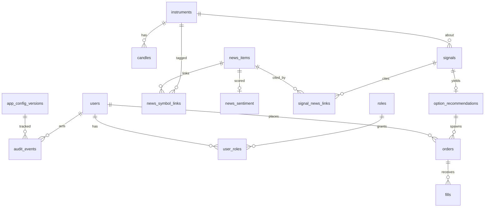

# Database schema — Options Signal Portal

**Primary store:** PostgreSQL 16+  
**Cache / queues / pub-sub:** Redis 7+ (not relational; noted where used)

All timestamps stored as `timestamptz` in UTC; UI and market calendar logic convert to **Asia/Kolkata (IST)**.

---

## ER overview



---

## Roles & users

```sql
CREATE TYPE user_role_name AS ENUM ('admin', 'analyst', 'guest');

CREATE TABLE users (
  id            UUID PRIMARY KEY DEFAULT gen_random_uuid(),
  email         CITEXT UNIQUE NOT NULL,
  display_name  TEXT NOT NULL,
  password_hash TEXT,                     -- null if local SSO / single-operator token
  is_active     BOOLEAN NOT NULL DEFAULT TRUE,
  created_at    TIMESTAMPTZ NOT NULL DEFAULT now(),
  updated_at    TIMESTAMPTZ NOT NULL DEFAULT now()
);

CREATE TABLE roles (
  id          SMALLSERIAL PRIMARY KEY,
  name        user_role_name UNIQUE NOT NULL,
  description TEXT
);

CREATE TABLE user_roles (
  user_id UUID NOT NULL REFERENCES users(id) ON DELETE CASCADE,
  role_id SMALLINT NOT NULL REFERENCES roles(id),
  PRIMARY KEY (user_id, role_id)
);
```

Seed: one local `admin` user (password from env at bootstrap).

---

## Instruments & candles

```sql
CREATE TYPE exchange_code AS ENUM ('NSE', 'BSE', 'NFO', 'BFO');
CREATE TYPE instrument_kind AS ENUM ('index', 'equity', 'index_fut', 'stock_fut', 'ce', 'pe');

CREATE TABLE instruments (
  id              UUID PRIMARY KEY DEFAULT gen_random_uuid(),
  exchange        exchange_code NOT NULL,
  symbol          TEXT NOT NULL,              -- e.g. NIFTY, BANKNIFTY, RELIANCE, TCS
  name            TEXT NOT NULL,
  kind            instrument_kind NOT NULL,
  lot_size        INTEGER,                    -- F&O lot size when applicable
  tick_size       NUMERIC(12,4),
  is_fno          BOOLEAN NOT NULL DEFAULT FALSE,
  underlying_id   UUID REFERENCES instruments(id),  -- for option/fut rows
  strike          NUMERIC(14,4),
  option_type     CHAR(2) CHECK (option_type IN ('CE','PE') OR option_type IS NULL),
  expiry_date     DATE,
  upstox_key      TEXT UNIQUE,                -- broker instrument key
  metadata        JSONB NOT NULL DEFAULT '{}',
  UNIQUE (exchange, symbol, kind, expiry_date, strike, option_type)
);

CREATE TABLE candles (
  instrument_id UUID NOT NULL REFERENCES instruments(id),
  timeframe     TEXT NOT NULL,               -- '5m','15m','1d'
  ts            TIMESTAMPTZ NOT NULL,        -- candle open time UTC
  open          NUMERIC(14,4) NOT NULL,
  high          NUMERIC(14,4) NOT NULL,
  low           NUMERIC(14,4) NOT NULL,
  close         NUMERIC(14,4) NOT NULL,
  volume        BIGINT NOT NULL DEFAULT 0,
  oi            BIGINT,                      -- for F&O if available
  source        TEXT NOT NULL DEFAULT 'upstox',
  PRIMARY KEY (instrument_id, timeframe, ts)
);

CREATE INDEX candles_ts_idx ON candles (timeframe, ts DESC);
```

Redis: `chain:{symbol}:{expiry}` JSON snapshot, TTL 30–60s during market hours.

---

## News & sentiment

```sql
CREATE TABLE news_items (
  id           UUID PRIMARY KEY DEFAULT gen_random_uuid(),
  source       TEXT NOT NULL,                -- moneycontrol|et|livemint|nse|bse|sebi
  external_id  TEXT,                         -- GUID/link hash
  url          TEXT,
  title        TEXT NOT NULL,
  body         TEXT,
  published_at TIMESTAMPTZ NOT NULL,
  ingested_at  TIMESTAMPTZ NOT NULL DEFAULT now(),
  content_hash CHAR(64) NOT NULL,             -- sha256 for dedupe
  raw          JSONB NOT NULL DEFAULT '{}',
  UNIQUE (source, content_hash)
);

CREATE TABLE news_symbol_links (
  news_id       UUID NOT NULL REFERENCES news_items(id) ON DELETE CASCADE,
  instrument_id UUID NOT NULL REFERENCES instruments(id),
  confidence    NUMERIC(5,4) NOT NULL DEFAULT 1.0,
  PRIMARY KEY (news_id, instrument_id)
);

CREATE TABLE news_sentiment (
  news_id       UUID PRIMARY KEY REFERENCES news_items(id) ON DELETE CASCADE,
  model         TEXT NOT NULL,               -- vader|finbert|ensemble
  score         NUMERIC(8,6) NOT NULL,       -- [-1, 1]
  label         TEXT NOT NULL,               -- bullish|bearish|neutral
  confidence    NUMERIC(5,4) NOT NULL,
  scored_at     TIMESTAMPTZ NOT NULL DEFAULT now(),
  details       JSONB NOT NULL DEFAULT '{}'
);
```

---

## Signals, recommendations, execution

```sql
CREATE TYPE signal_action AS ENUM (
  'HOLD', 'BUY_CE_BIAS', 'BUY_PE_BIAS', 'EXIT', 'REDUCE'
);
CREATE TYPE trading_mode AS ENUM ('dry_run', 'demo', 'live');
CREATE TYPE order_status AS ENUM (
  'proposed', 'submitted', 'open', 'partial', 'filled',
  'cancelled', 'rejected', 'simulated'
);

CREATE TABLE signals (
  id              UUID PRIMARY KEY DEFAULT gen_random_uuid(),
  instrument_id   UUID NOT NULL REFERENCES instruments(id),  -- underlying
  timeframe       TEXT NOT NULL DEFAULT '15m',
  bar_ts          TIMESTAMPTZ NOT NULL,       -- signal bar
  action          signal_action NOT NULL,
  tech_score      NUMERIC(8,6),
  news_score      NUMERIC(8,6),
  hybrid_score    NUMERIC(8,6) NOT NULL,
  confidence      NUMERIC(5,4) NOT NULL,
  reasons         JSONB NOT NULL DEFAULT '[]', -- TA rule hits, veto notes
  features        JSONB NOT NULL DEFAULT '{}', -- indicator snapshot
  model_versions  JSONB NOT NULL DEFAULT '{}',
  created_at      TIMESTAMPTZ NOT NULL DEFAULT now(),
  UNIQUE (instrument_id, timeframe, bar_ts, action)  -- tighten in app if multi-strategy
);

CREATE TABLE signal_news_links (
  signal_id UUID NOT NULL REFERENCES signals(id) ON DELETE CASCADE,
  news_id   UUID NOT NULL REFERENCES news_items(id),
  weight    NUMERIC(5,4) NOT NULL DEFAULT 1.0,
  PRIMARY KEY (signal_id, news_id)
);

CREATE TABLE option_recommendations (
  id              UUID PRIMARY KEY DEFAULT gen_random_uuid(),
  signal_id       UUID NOT NULL UNIQUE REFERENCES signals(id) ON DELETE CASCADE,
  legs            JSONB NOT NULL,            -- [{symbol, ce/pe, strike, expiry, qty_lots, limit}]
  expiry_date     DATE NOT NULL,
  spot_ref        NUMERIC(14,4),
  chain_snapshot  JSONB,                     -- trimmed chain used
  rationale       TEXT,
  created_at      TIMESTAMPTZ NOT NULL DEFAULT now()
);

CREATE TABLE orders (
  id                   UUID PRIMARY KEY DEFAULT gen_random_uuid(),
  recommendation_id    UUID REFERENCES option_recommendations(id),
  signal_id            UUID REFERENCES signals(id),
  user_id              UUID REFERENCES users(id),
  mode                 trading_mode NOT NULL,
  status               order_status NOT NULL,
  broker               TEXT NOT NULL DEFAULT 'upstox',
  client_order_id      TEXT NOT NULL UNIQUE,  -- idempotency key
  broker_order_id      TEXT,
  side                 TEXT NOT NULL,         -- BUY/SELL
  product              TEXT NOT NULL,         -- NRML/MIS
  quantity             INTEGER NOT NULL,      -- shares = lots * lot_size
  limit_price          NUMERIC(14,4),
  instrument_id        UUID REFERENCES instruments(id),  -- option contract
  payload              JSONB NOT NULL DEFAULT '{}',
  error_message        TEXT,
  created_at           TIMESTAMPTZ NOT NULL DEFAULT now(),
  updated_at           TIMESTAMPTZ NOT NULL DEFAULT now()
);

CREATE TABLE fills (
  id           UUID PRIMARY KEY DEFAULT gen_random_uuid(),
  order_id     UUID NOT NULL REFERENCES orders(id) ON DELETE CASCADE,
  qty          INTEGER NOT NULL,
  price        NUMERIC(14,4) NOT NULL,
  fees_est     NUMERIC(14,4) DEFAULT 0,
  filled_at    TIMESTAMPTZ NOT NULL DEFAULT now(),
  raw          JSONB NOT NULL DEFAULT '{}'
);

CREATE TABLE positions (
  id              UUID PRIMARY KEY DEFAULT gen_random_uuid(),
  mode            trading_mode NOT NULL,
  instrument_id   UUID NOT NULL REFERENCES instruments(id),
  qty             INTEGER NOT NULL,           -- signed
  avg_price       NUMERIC(14,4) NOT NULL,
  realized_pnl    NUMERIC(14,4) NOT NULL DEFAULT 0,
  updated_at      TIMESTAMPTZ NOT NULL DEFAULT now(),
  UNIQUE (mode, instrument_id)
);

CREATE TABLE pnl_snapshots (
  id         UUID PRIMARY KEY DEFAULT gen_random_uuid(),
  mode       trading_mode NOT NULL,
  as_of      TIMESTAMPTZ NOT NULL,
  realized   NUMERIC(14,4) NOT NULL,
  unrealized NUMERIC(14,4) NOT NULL,
  details    JSONB NOT NULL DEFAULT '{}',
  UNIQUE (mode, as_of)
);
```

---

## Config, audit, health

```sql
CREATE TABLE app_config_versions (
  id          BIGSERIAL PRIMARY KEY,
  key         TEXT NOT NULL,                 -- e.g. trading.mode, hybrid.weights
  value       JSONB NOT NULL,
  version     INTEGER NOT NULL,
  changed_by  UUID REFERENCES users(id),
  changed_at  TIMESTAMPTZ NOT NULL DEFAULT now(),
  UNIQUE (key, version)
);

-- Effective config view: latest version per key (app-layer or SQL view)

CREATE TABLE audit_events (
  id          BIGSERIAL PRIMARY KEY,
  ts          TIMESTAMPTZ NOT NULL DEFAULT now(),
  actor_user  UUID REFERENCES users(id),
  category    TEXT NOT NULL,                 -- pipeline|order|config|auth|health
  action      TEXT NOT NULL,
  entity_type TEXT,
  entity_id   TEXT,
  severity    TEXT NOT NULL DEFAULT 'info',
  payload     JSONB NOT NULL DEFAULT '{}',
  correlation_id UUID                        -- ties one pipeline tick together
);

CREATE INDEX audit_ts_idx ON audit_events (ts DESC);
CREATE INDEX audit_corr_idx ON audit_events (correlation_id);

CREATE TABLE health_checks (
  id           BIGSERIAL PRIMARY KEY,
  component    TEXT NOT NULL,                -- upstox|rss:et|worker|postgres|redis|finbert
  status       TEXT NOT NULL,                -- ok|degraded|down
  checked_at   TIMESTAMPTZ NOT NULL DEFAULT now(),
  latency_ms   INTEGER,
  detail       JSONB NOT NULL DEFAULT '{}'
);

CREATE INDEX health_component_ts ON health_checks (component, checked_at DESC);

-- Optional backtest metadata
CREATE TABLE backtest_runs (
  id           UUID PRIMARY KEY DEFAULT gen_random_uuid(),
  name         TEXT NOT NULL,
  params       JSONB NOT NULL,
  metrics      JSONB NOT NULL DEFAULT '{}',
  started_at   TIMESTAMPTZ NOT NULL DEFAULT now(),
  finished_at  TIMESTAMPTZ,
  status       TEXT NOT NULL DEFAULT 'running'
);
```

---

## Redis key layout (convention)

| Key | Purpose | TTL |
|-----|---------|-----|
| `session:{id}` | Portal session | session length |
| `ratelimit:upstox:{window}` | API throttle | window length |
| `chain:{symbol}:{expiry}` | Option chain cache | 30–60s |
| `pubsub:portal` | WS fan-out channel | — |
| `queue:news_score` | Sentiment jobs | — |
| `lock:pipeline:{symbol}:{tf}` | Single-flight pipeline | short |

---

## Migration notes

- Use Alembic (Python) or Flyway/Prisma — one tool, forward-only migrations in `db/migrations/`.
- JSONB payloads keep first versions flexible; promote hot query fields to columns when stable.
- Partition `candles` and `audit_events` by month if volume grows.
